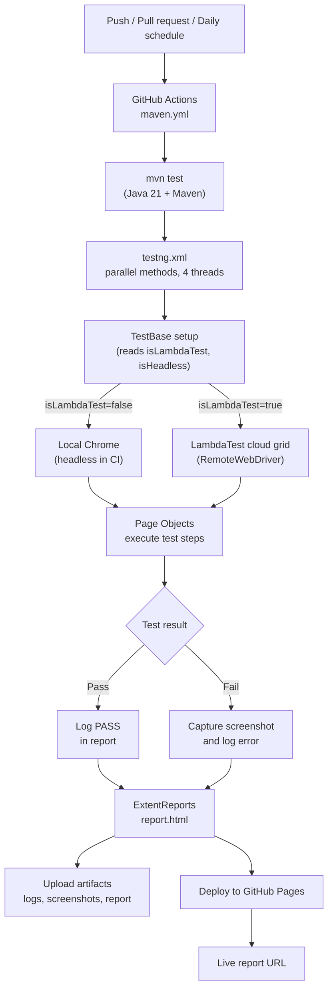

# Test Automation Framework: Java 21 | Selenium | TestNG | LambdaTest

<div align="center">

### Pranab Sarkar
**SDET / Test Automation Engineer**

<a href="https://www.linkedin.com/in/pranabsarkar/" target="_blank">
  
</a>
&nbsp;
<a href="https://github.com/SarkarPranab" target="_blank">
  
</a>
&nbsp;
<a href="https://pranabsarkar.vercel.app/" target="_blank">
  
</a>

</div>

---

A UI test automation framework built on **Java 21**, **Selenium 4** and **TestNG**, using the Page Object Model. Tests run on a local browser or on the **LambdaTest** cloud grid, in parallel, with an **ExtentReports** HTML report that is published to **GitHub Pages** automatically by **GitHub Actions**.

**Live report (latest run):** https://sarkarpranab.github.io/Test-Automation-Framework-Java-21-TestNG-LambdaTest/report.html

> **Application under test:** _add the site URL here_

> **Note on the live report:** two tests (`checkoutTest` and `verifyProductSearchTest`) intentionally use unstable locators. They fail on purpose to demonstrate that a screenshot is captured on failure and attached to the report. Every other test is expected to pass.

---

## Features

- **Page Object Model** with a shared `TestBase` for setup and teardown
- **Local or cloud execution**: switch between a local Chrome and LambdaTest with a single Maven flag
- **Headless mode** for CI runs
- **Parallel execution** configured in `testng.xml` (`parallel="methods"`, `thread-count="4"`)
- **Thread-safe LambdaTest sessions** and report entries using `ThreadLocal`
- **ExtentReports (Spark)** HTML report with pass/fail status, logs and failure screenshots
- **Screenshot on failure**, captured by a TestNG listener and embedded in the report
- **Retry analyzer** for failed tests, with the retry limit read from `config/config.json`
- **Data-driven tests** using CSV, Excel (Apache POI) and JSON readers plus TestNG data providers
- **Fake test data** generation with JavaFaker
- **Environment config** per environment (`dev`, `qa`, `uat`) through properties files
- **Logging** with Log4j2
- **CI/CD** with GitHub Actions: runs on every push and pull request to `master`, and on a daily schedule

---

## Execution flow



---

## Tech stack

| Area | Tool | Version |
| --- | --- | --- |
| Language | Java | 21 |
| Browser automation | Selenium WebDriver | 4.50.0 |
| Test runner | TestNG | 7.9.0 |
| Build | Maven (Surefire 3.6.0, Compiler 3.16.0) | |
| Cloud grid | LambdaTest (RemoteWebDriver) | |
| Reporting | ExtentReports | 5.1.2 |
| Logging | Log4j2 | 2.24.1 |
| Data | OpenCSV 5.7.1, Apache POI 5.4.0, Gson 2.10.1, JavaFaker 1.0.2 | |
| CI/CD | GitHub Actions, GitHub Pages | |

---

## Project structure

```
.
├── .github/workflows/maven.yml     # CI: run tests, upload artifacts, publish report
├── config/
│   ├── config.json                 # e.g. max retry attempts
│   ├── dev.properties
│   ├── qa.properties               # LambdaTest settings (see below)
│   └── uat.properties
├── testData/
│   ├── LoginData.xlsx
│   ├── loginData.csv
│   └── loginData.json
├── src/test/resources/log4j2.xml
├── src/test/java/org/pranabsarkar/com/
│   ├── constants/                  # Browsers, Env, Size
│   ├── ui/
│   │   ├── dataproviders/          # LoginDataProvider
│   │   ├── listeners/              # TestListeners, MyRetryAnalyzer
│   │   ├── pages/                  # Page objects (Home, Login, MyAccount, Search,
│   │   │                           #   ProductDetails, ShoppingCart, Address,
│   │   │                           #   ConfirmAddress, Shipment, OrderCheckOutPayment)
│   │   ├── pojo/                   # AddressPOJO, Config, TestData, User, ...
│   │   └── tests/                  # TestBase + test classes
│   └── utility/                    # BrowserUtility, LambdaTestUtility,
│                                   #   ExtentReporterUtility, LoggerUtility,
│                                   #   PropertiesUtil, JSONUtility, CSVReaderUtility,
│                                   #   ExcelReaderUtility, FakeAddressUtility
├── pom.xml
└── testng.xml
```

---

## Test suite

Defined in `testng.xml` (suite: *Automation Practice Test Suite*):

| Class | Scenario |
| --- | --- |
| `LoginTest` | Login with valid credentials (data-driven) |
| `InvalidCredsLoginTests` | Login with invalid credentials |
| `SearchProductTests` | Product search |
| `ProductCheckoutTest` | Product checkout flow |
| `AddNewAddressTest` | Add a new address |

---

## Getting started

### Prerequisites

- JDK 21
- Maven 3.8 or later
- Google Chrome (for local runs)
- A LambdaTest account (only for cloud runs)

### Clone

```bash
git clone https://github.com/SarkarPranab/Test-Automation-Framework-Java-21-TestNG-LambdaTest.git
cd Test-Automation-Framework-Java-21-TestNG-LambdaTest
```

### Run locally

```bash
# Headed Chrome
mvn clean test -Dbrowser=chrome -DisLambdaTest=false -DisHeadless=false

# Headless Chrome (what CI uses)
mvn clean test -Dbrowser=chrome -DisLambdaTest=false -DisHeadless=true
```

### Run on LambdaTest

```bash
mvn clean test -Dbrowser=chrome -DisLambdaTest=true -DisHeadless=true
```

LambdaTest settings are read from the properties file for the environment (`config/qa.properties`):

| Key | Purpose |
| --- | --- |
| `LT_USERNAME` | LambdaTest username |
| `LT_ACCESS_KEY` | LambdaTest access key |
| `LT_BROWSER` | Browser name (for example `Chrome`) |
| `LT_BROWSER_VERSION` | Browser version |
| `LT_PROJECT` | Project name shown in the LambdaTest dashboard |
| `LT_BUILD` | Build name shown in the LambdaTest dashboard |

> **Never commit real credentials.** Use your own LambdaTest account and keep your username and access key out of version control.

### Maven parameters

| Parameter | Values | Description |
| --- | --- | --- |
| `-Dbrowser` | `chrome` | Browser to run |
| `-DisLambdaTest` | `true` / `false` | Run on LambdaTest or locally |
| `-DisHeadless` | `true` / `false` | Run the browser headless |

---

## Reports, screenshots and logs

After a run:

- **HTML report:** `report.html` in the project root (ExtentReports Spark)
- **Failure screenshots:** `screenshots/`
- **Logs:** `logs/`

These folders are git-ignored; CI regenerates and publishes them on every run.

---

## CI/CD (GitHub Actions)

Workflow: `.github/workflows/maven.yml`

**Triggers**

- Push and pull requests to `master`
- Daily schedule at `23:30 UTC` (05:00 IST)

**Steps**

1. Check out the code and set up JDK 21 (Temurin, Maven cache)
2. Run `mvn test -Dbrowser=chrome -DisLambdaTest=false -DisHeadless=true` (headless Chrome on the GitHub runner)
3. Upload logs, screenshots and `report.html` as workflow artifacts (even when tests fail)
4. Copy the report and screenshots into a publish folder
5. Deploy that folder to the **GitHub Pages** branch using `JamesIves/github-pages-deploy-action`

LambdaTest execution is switched on by passing `-DisLambdaTest=true` (see above), for example in a manual run.

### Enabling the Pages report in your own fork

1. Create a personal access token with repository write access and save it as the repository secret `PAT_J21TEST_NG`.
2. After the first workflow run, open **Settings → Pages** and select the `gh-pages` branch as the source.
3. The report is then served at `https://<your-username>.github.io/<repo-name>/report.html`.

---

## Adding a new test

1. Create a page object under `ui/pages/` for the new screen.
2. Create a test class under `ui/tests/` that extends `TestBase`.
3. Register the class in `testng.xml`.
4. Run the suite. The listener adds the test to the report and captures a screenshot if it fails.
